  

  
  
  

# Привет, я Вадим 👋

**Python-разработчик (Backend)** · FastAPI · Django REST Framework · PostgreSQL · Docker

Разрабатываю REST API и бэкенд веб-сервисов: от модели данных и бизнес-логики до тестов, Docker и автодеплоя на сервер.
Сейчас автоматизирую рабочие процессы в Битрикс24: моя программа списания материальных ценностей сократила оформление с 2 часов до 5–10 минут, а чат-бот с напоминаниями по сделкам — проверку сделок с 30 минут до 1 минуты.
Уверенно применяю AI-инструменты (LLM) в разработке.

🔎 **Открыт к предложениям** — удалённая работа, полный день.

## 📈 Результаты в цифрах

| | | |
|:---:|:---:|:---:|
| **2 ч → 5–10 мин** оформление списания в Битрикс24 | **30 мин → 1 мин** проверка сделок чат-ботом | **87 / 87** автотестов в QRKot |
| **4 контейнера** Foodgram в Docker Compose | **3 образа → автодеплой** CI/CD Kittygram на GitHub Actions | **35 тестов** написаны с нуля на pytest и unittest |

## 🛠 Технологии

**Backend:** Python, FastAPI, Django, Django REST Framework, SQLAlchemy, Alembic, asyncio, REST API 
**Данные:** PostgreSQL, SQL 
**DevOps:** Docker, Docker Compose, Nginx, GitHub Actions (CI/CD), Linux 
**Инструменты:** Git, Pytest, Postman, Битрикс24

  
  
  
  
  
  
  
  
  
  
  
  

## 📂 Проекты

| Проект | Что это | Стек |
|---|---|---|
| 🐈 [QRKot](https://github.com/vadim-guseinov/QRkot-spreadsheets) | Асинхронный API благотворительного фонда, 87/87 тестов | FastAPI, SQLAlchemy 2.0, Alembic, JWT |
| 🍲 [Foodgram](https://github.com/vadim-guseinov/foodgram) | Сервис рецептов, 4 Docker-контейнера, деплой на сервер | Django, DRF, PostgreSQL, Nginx |
| 🐾 [Kittygram](https://github.com/vadim-guseinov/kittygram_final) | CI/CD: тесты → Docker Hub → автодеплой → Telegram | Docker, GitHub Actions |
| 📝 [Yatube API](https://github.com/vadim-guseinov/api-final-yatube) | REST API соцсети | DRF, JWT |
| 🕷 [PEP Parser](https://github.com/vadim-guseinov/scrapy_parser_pep) | Парсер PEP со статистикой в CSV | Scrapy |

<b>Ещё проекты</b>

| Проект | Что это | Стек |
|---|---|---|
| ✂️ [YaCut](https://github.com/vadim-guseinov/async-yacut) | Сокращатель ссылок с загрузкой файлов на Яндекс Диск | Flask, aiohttp, SQLAlchemy |
| 🤖 [Homework Bot](https://github.com/vadim-guseinov/homework-bot) | Telegram-бот, отслеживающий статус через внешний API | requests, pyTelegramBotAPI |
| 📰 [Blogicum](https://github.com/vadim-guseinov/django-sprint4) | Блог-платформа: посты, комментарии, профили | Django, ORM, Bootstrap 5 |
| 🧪 [Django Testing](https://github.com/vadim-guseinov/django-testing) | 35 тестов для двух Django-приложений | pytest, unittest |
| 🖥 [Infra](https://github.com/vadim-guseinov/infra_sprint1) | Деплой на Ubuntu: Gunicorn, Nginx, HTTPS | Nginx, systemd, Let's Encrypt |
| 🔎 [PEP Parser BS4](https://github.com/vadim-guseinov/bs4_parser_pep) | CLI-парсер документации Python | BeautifulSoup, requests-cache |

## 📚 Изучаю сейчас

«Грокаем алгоритмы» (А. Бхаргава), «Чистый код» (Р. Мартин), документация Python, Django и FastAPI, Хабр, Real Python.

## 📫 Контакты

[Telegram](https://t.me/eviliing) · guseinov.vadimka@yandex.ru
